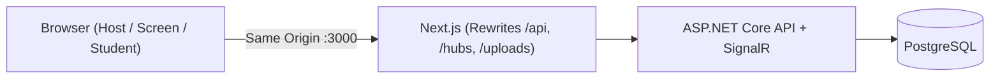

# QuizLive

Production-ready, real-time, Kahoot-style live quiz platform built with ASP.NET Core (.NET 10), SignalR, PostgreSQL, and Next.js.

## Quick Start (Docker Compose)

1. Copy environment variables:
   ```bash
   cp .env.example .env
   ```
2. Start PostgreSQL, Backend API, and Frontend Web:
   ```bash
   docker compose up --build
   ```
3. Open `http://localhost:3000/admin/login` and sign in with the seeded admin credentials from `.env` (default: `admin@quizlive.local` / `ChangeMe123!`).

## Architecture



## Running Tests & Load Bots

```bash
# Backend unit tests
cd backend && dotnet test tests/QuizLive.UnitTests/QuizLive.UnitTests.csproj

# Backend integration tests (requires Docker for Testcontainers)
cd backend && dotnet test tests/QuizLive.IntegrationTests/QuizLive.IntegrationTests.csproj

# Frontend lint, typecheck, unit tests, build
cd frontend && npm run lint && npm run typecheck && npm test && npm run build

# 300-bot load test against a running server
cd backend && dotnet run --project tests/QuizLive.LoadBots -- --url http://localhost:5000 --pin 123456 --bots 300 --questions 5
```

## Reverse Proxy Deployment Notes
- Enable **WebSockets** (`Upgrade` and `Connection: upgrade` headers) for `/hubs/*`.
- Enable **sticky sessions** if running multiple API instances without a Redis SignalR backplane.

## Documentation
- [Architecture](docs/ARCHITECTURE.md)
- [Architecture Decisions](docs/DECISIONS.md)
- [REST API](docs/API.md)
- [SignalR Events](docs/EVENTS.md)
